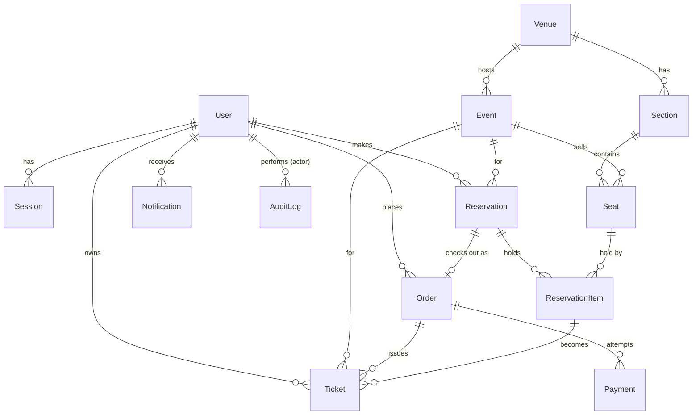

# Database (Phase 3)

PostgreSQL is the source of truth for this entire system (section 28's
mental model, restated because it's the axis everything else hangs off:
"PostgreSQL: what is actually true"). This document covers the schema in
`packages/database/prisma/schema.prisma`, why it's shaped the way it is,
and the handful of things Prisma's schema language cannot express that
were added by hand.

## ER model



`OutboxEvent`, `IdempotencyKey`, and `ProcessedEvent` are standalone
tables with no foreign keys into the domain model on purpose — they're
infrastructure tables that reference domain rows by loosely-typed
`aggregateId`/similar string fields, not real relations, because an
outbox row must be insertable regardless of which domain table it's
describing.

## Why Seat belongs to (Event, Section), not just Section

A venue's physical layout (`Section`) is reusable across every event held
there — Delhi Stadium's "Section A" exists once. But seat *inventory* —
price, availability, whether it's sold — is specific to one event. The
same physical seat is a different `Seat` row for every event, created
fresh as part of setting up that event's ticket inventory (section 3).
This is why `Seat` carries both `eventId` and `sectionId`, and why
`unique(eventId, sectionId, seatCode)` is the identity constraint, not
just `unique(sectionId, seatCode)`.

## The seat-locking invariant: `ReservationItem.status`, not `Reservation.status`

This is the single most important design decision in the schema, so it's
worth spelling out precisely.

`Reservation.status` churns through a payment lifecycle: `RESERVED` →
`PENDING_PAYMENT` → `CONFIRMED` (or → `EXPIRED`/`CANCELLED`). If the
seat-lock invariant were expressed against that column — e.g. "unique
seat_id where reservation status is RESERVED or PENDING_PAYMENT" — every
status transition would need to keep that condition in sync, and the
invariant's meaning would depend on an enum that has nothing to do with
seat occupancy.

Instead, `ReservationItem` gets its own two-state status:

- `ACTIVE` — this seat is currently held by this reservation, full stop,
  regardless of what the parent reservation's payment status is doing.
- `RELEASED` — the hold ended (expired, cancelled, or superseded).

The entire correctness guarantee is one partial unique index, added by
hand in `migrations/.../migration.sql` because Prisma's schema language
has no partial-index syntax:

```sql
CREATE UNIQUE INDEX "reservation_items_active_seat_unique"
  ON "reservation_items"("seat_id")
  WHERE "status" = 'ACTIVE';
```

A **plain** `UNIQUE(seat_id)` would have been wrong: it would permanently
block a seat from ever being reserved again after its first hold expired,
since the old `RELEASED` row would still collide. The `WHERE` clause is
what makes this mean "unique only among *currently active* holds" — this
was verified directly against the running database as part of this phase:

```
NOTICE: first insert succeeded
NOTICE: second insert correctly REJECTED: duplicate key value violates
        unique constraint "reservation_items_active_seat_unique"
...
NOTICE: released the active hold on seat ...
NOTICE: re-reservation after release correctly SUCCEEDED
```

Two concurrent transactions racing to insert an `ACTIVE` row for the same
`seat_id` will have exactly one succeed; the loser gets a Postgres
`unique_violation` (error `23505`) that the reservation service (Phase 9)
catches and turns into a `SEAT_NOT_AVAILABLE` response. **This is the
actual correctness boundary for "one seat = one active reservation"** —
the Redis distributed lock in the reservation flow only reduces how often
two requests reach this point at all; it is not what prevents the double
booking.

The same pattern protects ticket issuance one step further down the
pipeline: `tickets_active_reservation_item_unique` is a partial unique
index on `(reservation_item_id) WHERE status = 'ISSUED'`, which is why
`Ticket.reservationItemId` is **not** `@unique` in `schema.prisma` and
`ReservationItem.tickets` is an array, not an optional singular relation
— Prisma requires a plain unique constraint to model a true 1:1, but the
real constraint here deliberately allows a `CANCELLED` ticket row to
coexist with a later reissued one for the same seat.

## Indexes, and why each one exists

| Table | Index | Query it serves |
|---|---|---|
| `users` | `email` unique | Login lookup |
| `events` | `status` | Admin filtering by draft/published/etc. |
| `events` | `start_time` | Sort/filter upcoming events |
| `events` | `venue_id` | "Events at this venue" |
| `events` | `(status, start_time)` | The actual public browse query: published events, soonest first — one composite beats two separate indexes for this specific access pattern |
| `seats` | `(event_id, status)` | "Find available seats for this event" — the hottest read in the whole system during a flash sale |
| `seats` | `(event_id, section_id, seat_code)` unique | Seat identity |
| `reservations` | `user_id` | "My reservations" |
| `reservations` | `event_id` | Admin/analytics per-event view |
| `reservations` | `(status, expires_at)` | The expiry sweeper's exact query (Phase 9): `WHERE status = 'RESERVED' AND expires_at < now()` |
| `reservation_items` | `(seat_id) WHERE status='ACTIVE'` (partial, unique) | The correctness invariant above |
| `reservation_items` | `seat_id` (plain) | Lookups across all statuses, not just ACTIVE |
| `orders` | `user_id`, `status` | "My orders", admin filtering |
| `tickets` | `user_id`, `event_id` | "My tickets", admin per-event view |
| `outbox_events` | `(status, created_at)` | The outbox publisher's exact query: `WHERE status='PENDING' ORDER BY created_at` |
| `idempotency_keys` | `(route, key)` unique | Scoped per-endpoint, not globally — a client-supplied key is only meaningful within the route it was sent to |
| `processed_events` | `(consumer_group, event_id)` unique | Consumer idempotency (Phase 11) |

No index was added speculatively — every one above maps to a specific
named query pattern from the project's phases, per section 29's "don't
blindly create indexes."

## ID strategy: UUIDv4, with the trade-off stated honestly

Every primary key is a database-generated UUIDv4 (`gen_random_uuid()`,
built into Postgres core since v13 — no extension required). This was a
deliberate choice with a real cost, not a default left unexamined:

**Why UUID over a sequential integer:** ticket/reservation/order IDs are
exposed in URLs and API responses. A sequential integer PK leaks business
information (total volume, growth rate, guessability for IDOR-style
probing). UUIDs avoid that by construction.

**The cost:** random UUIDv4 values scatter uniformly across a B-tree
index's keyspace, causing page splits and index bloat under heavy
concurrent insert load — precisely the flash-sale write pattern this
project is built to handle. Time-ordered identifiers (UUIDv7, or ULID)
avoid this by keeping inserts append-mostly at the right edge of the
index, the same way a sequential integer does.

**Why not UUIDv7 now:** it requires either a Postgres extension
(`pg_uuidv7`) not present in the stock `postgres:17-alpine` image, or
generating it application-side and threading that through every model's
default. Given this project's current scale target and the goal of not
introducing infrastructure dependencies before they're needed (section
58), that felt like the wrong trade to make in Phase 3.

**The mitigation path, if write throughput on `reservation_items`/`seats`
ever becomes the bottleneck under load testing (Phase 18):** either add
the `pg_uuidv7` extension and switch ID generation, or split into an
internal `BIGINT IDENTITY` primary key (fast, sequential, index-friendly)
plus a separate indexed `publicId` UUID column for anything exposed
externally. Not implemented now — flagged here so it's a deliberate future
decision, not a surprise.

## Money: `Int` vs `BigInt`, never float

All money fields are integer minor units (paise/cents), never a
floating-point type — floats cannot represent currency exactly, and
"off by half a paisa" is not an acceptable failure mode for a payments
system. `Seat.priceMinor` is `Int` (a single seat's price fits
comfortably); `Order.amountMinor` and `Payment.amountMinor` are `BigInt`
because they're a sum across up to `MAX_SEATS_PER_RESERVATION` (6) seats
and deserve the extra headroom.

Two CHECK constraints (also hand-written, same reason as the partial
indexes) back this up at the database level:

```sql
ALTER TABLE "seats" ADD CONSTRAINT "seats_price_minor_nonnegative" CHECK ("price_minor" >= 0);
ALTER TABLE "orders" ADD CONSTRAINT "orders_amount_minor_nonnegative" CHECK ("amount_minor" >= 0);
ALTER TABLE "payments" ADD CONSTRAINT "payments_amount_minor_nonnegative" CHECK ("amount_minor" >= 0);
```

Zod validation at the API boundary (Phase 4+) is the first line of
defense against a negative amount; these constraints are what holds even
if application code has a bug.

## Why there's a `Session` table when sessions live in Redis

These are not duplicates of the same data. `session:{sessionId}` in Redis
(Phase 4) is the actual fast-path lookup used on every authenticated
request — high write volume (touched, at minimum, on login and logout;
Phase 4 decides whether `lastActivityAt` bumps it further), fully
ephemeral, gone the moment its TTL expires or Redis restarts without AOF.

The Postgres `Session` row is a lightweight **audit/index** record,
written once at login and once at logout/revocation — not on every
request. It exists so "log out of all devices" and admin visibility into
active sessions don't require `SCAN`ning Redis's keyspace, which is a
well-known production anti-pattern (it blocks the single-threaded Redis
event loop proportionally to keyspace size). `Session.id` has **no
database default** — the auth service generates the session ID once and
uses that exact value as both the Redis key suffix and this row's primary
key, so the two can never disagree about identity.

## Why there's no `EventView`/`EventLike` table

Section 28 lists these as "potential additional models." They're
deliberately not here. View counts and likes are exactly the kind of
ephemeral, high-write, approximate data Redis counters and sets exist for
(`counter:event:{id}:views` via `INCR`, `event:{id}:likes` via a Set,
Phase 7) — durability to the level Postgres provides isn't needed for "how
many people looked at this page," and writing every page view to Postgres
would add write load to the source-of-truth database for data nobody
needs transactional guarantees on. If this project later needs durable
historical analytics (e.g., daily view counts over a year), that's a
periodic Redis→Postgres rollup job, not a per-view Postgres write.

## `prisma generate` lives in this package's `build` script, not `postinstall`

`packages/database/package.json`'s `build` script is `prisma generate &&
tsc`, not a `postinstall` hook. This matters once `apps/api`/`apps/worker`
depend on this package (Phase 4) and get built by the Phase 2 Docker
pattern: the installer stage only copies pruned `package.json` files
(`turbo prune --docker`'s `out/json/`), not `prisma/schema.prisma` — a
`postinstall: prisma generate` would run during `pnpm install` in that
stage and fail because the schema file doesn't exist there yet. Folding
`prisma generate` into `build` instead means it only runs in the builder
stage, after the full pruned source (including `schema.prisma`) has been
copied in. This wasn't hit as a real Docker failure yet (this package
isn't wired into the app Dockerfiles until Phase 4), but it's a
well-documented pitfall avoided proactively rather than discovered later.

## Local development

```bash
docker compose up -d postgres            # from Phase 2
pnpm --filter @flashsale/database migrate:deploy   # apply migrations, non-interactive
pnpm --filter @flashsale/database seed             # idempotent — safe to re-run
```

`migrate:dev` (interactive, prompts for a migration name on schema
changes) is for authoring new migrations locally; `migrate:deploy`
(non-interactive, applies whatever migrations already exist) is what CI
and Docker builds use, and what the seed workflow above assumes. All
`packages/database` scripts run through `dotenv-cli` pointed at the repo
root `.env` (`dotenv -e ../../.env -- prisma ...`) because Prisma's CLI
otherwise looks for a `.env` file relative to `schema.prisma`, not the
monorepo root.

Seeded accounts (local dev only — see the `LOCAL DEVELOPMENT
SIMPLIFICATION` note in `prisma/seed.ts`):

| Role | Email | Password |
|---|---|---|
| Admin | `admin@flashsale.dev` | `Password123!` |
| User | `fan@flashsale.dev` | `Password123!` |

Plus one venue (Delhi Stadium, 4 sections), one published event (India vs
Australia), and 40 seats (10 per section) — enough to exercise multi-seat
reservation without seeding thousands of rows for local development.
