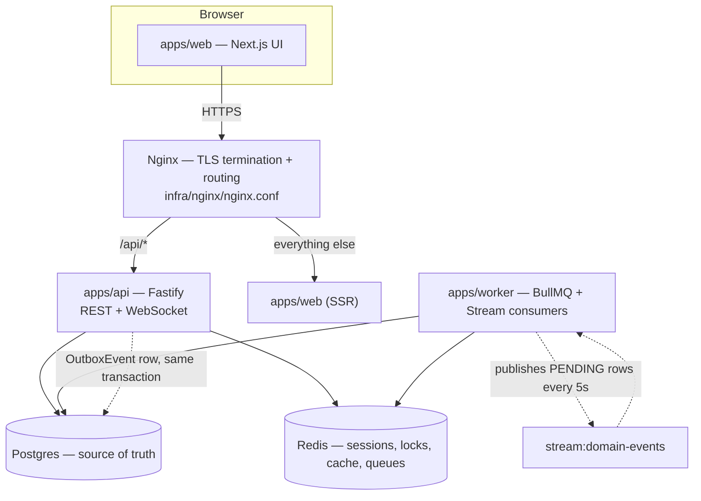
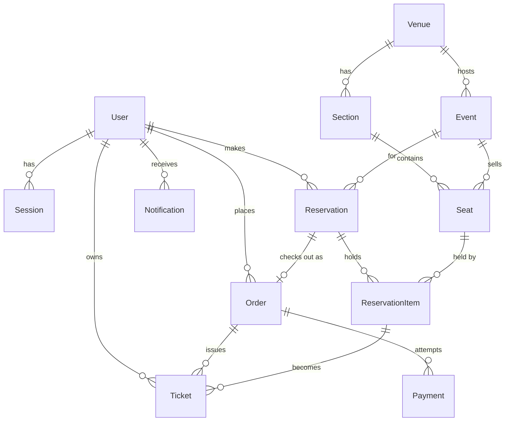
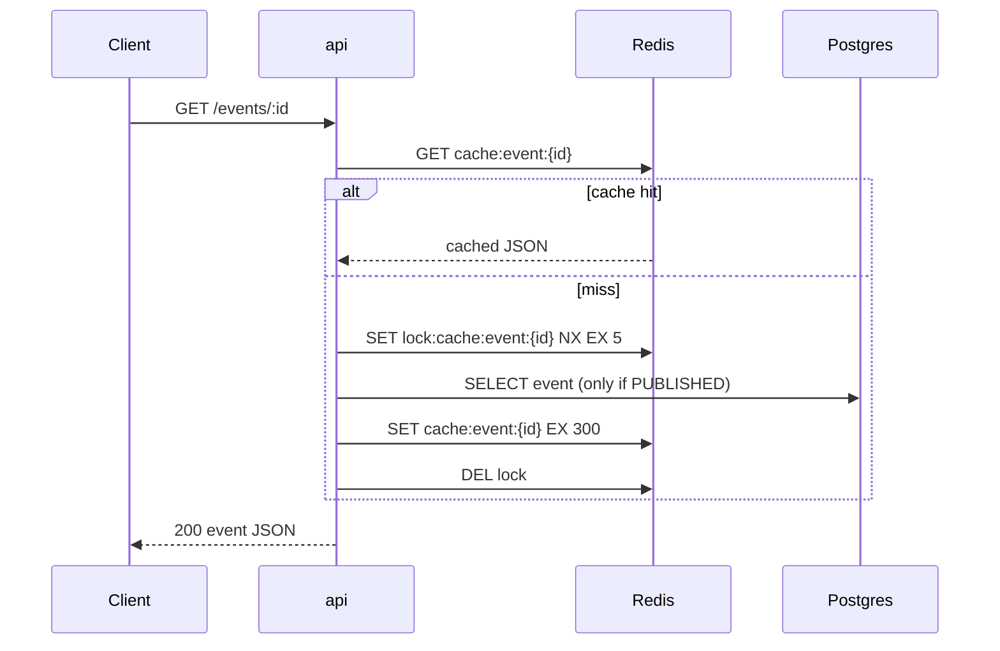
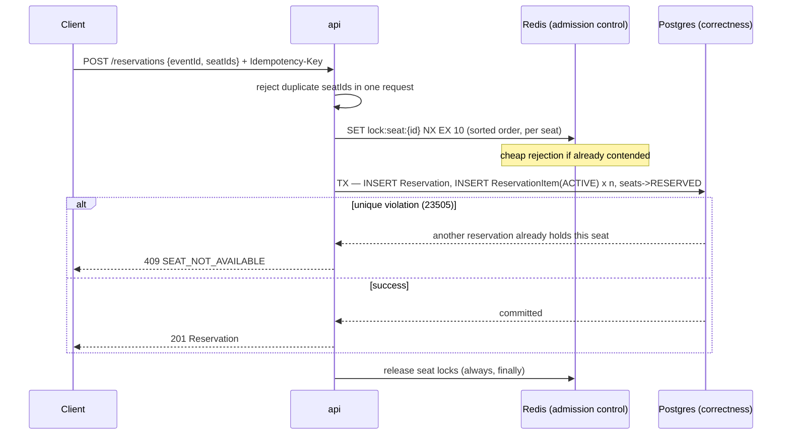
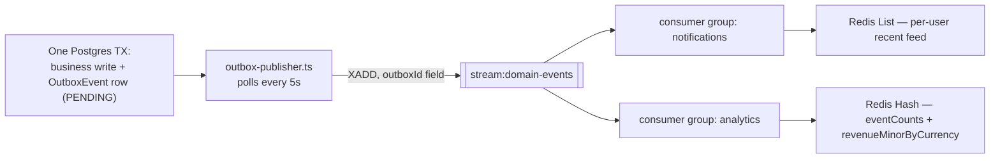

# FLASHSALE — System Reference

A flash-sale event ticketing platform: browse events, hold seats under real
concurrency, pay, and get tickets — with a full admin console to set the
whole thing up. This document ties the high-level architecture, the
low-level design behind every domain, the complete file list, the customer
and admin flows, and a runnable load-test walkthrough together in one place,
so it can be handed to someone else who then drives the whole system without
reading 22 separate phase documents.

**Stack**: Fastify (`apps/api`) · BullMQ + Redis Streams (`apps/worker`) ·
Next.js 16 App Router (`apps/web`) · Postgres/Prisma · Redis · Docker · k6.

**At a glance**: 22 build phases · ~185 source files · 9 Postgres tables ·
9 Redis key families · 3 BullMQ queues · 2 Stream consumer groups.

---

## Table of contents

1. [Overview](#1-overview)
2. [High-level design](#2-high-level-design)
3. [Data model](#3-data-model)
4. [Low-level design, by domain](#4-low-level-design-by-domain)
5. [Frontend — apps/web](#5-frontend--appsweb)
6. [Complete file catalog](#6-complete-file-catalog)
7. [End-to-end flows](#7-end-to-end-flows)
8. [Verification strategy](#8-verification-strategy)
9. [Load testing walkthrough](#9-load-testing-walkthrough)
10. [Demo script](#10-demo-script)
11. [Local dev cheat sheet](#11-local-dev-cheat-sheet)

---

## 1. Overview

FLASHSALE is a pnpm/Turborepo monorepo with three runtime apps —
`apps/api` (Fastify REST + WebSocket API), `apps/worker` (BullMQ jobs +
Redis Stream consumers, no HTTP request surface), and `apps/web` (Next.js
16 App Router UI) — plus five shared packages (`database`, `redis`,
`shared`, `logger`, `config`).

Postgres is the single source of truth for everything that must never be
wrong (seat ownership, money, tickets). Redis is used everywhere something
needs to be **fast** or **ephemeral** (sessions, locks, caches, counters,
queues, pub/sub) but is never the final word on correctness.

---

## 2. High-level design



### Why three separate processes, not one monolith

**apps/api** is request/response only — it never runs a background loop.
**apps/worker** owns everything time-based or queued: the reservation-expiry
sweeper, the outbox publisher, two Stream consumer groups, and three BullMQ
queues. Splitting them means a slow bulk seat-generation job or a Redis
Stream backlog can never block an HTTP request thread, and either process
can restart or scale independently. **Nginx** exists for exactly two jobs —
TLS termination and path-based routing (`/api/*` → api, everything else →
web) — which is also exactly why the AWS deployment (Terraform) drops Nginx
entirely and gives both jobs to an Application Load Balancer instead.

### The one rule everything else follows

> **Design axiom:** Postgres is the correctness boundary. Redis is admission
> control. A Redis outage can make the system slower or noisier — it can
> never make a seat double-booked, a payment double-charged, or a ticket
> wrong. Every Redis usage in this system is either a fail-open optimization
> (locks, caches, rate limits) or explicitly documented as the one thing
> that can't fail open (session lookup — see [§4.7](#47-rate-limiting-csrf--production-hardening)).

---

## 3. Data model

`packages/database/prisma/schema.prisma` — the schema every other phase
builds on (Phase 3).



### The one invariant that makes seat-locking correct

Not `Reservation.status` — that churns through a payment lifecycle. The
real lock is a partial unique index on the child row:

```sql
CREATE UNIQUE INDEX reservation_items_active_seat_unique
  ON reservation_items(seat_id)
  WHERE status = 'ACTIVE';
```

Two transactions racing to insert an `ACTIVE` row for one seat: exactly one
wins, the other gets Postgres error `23505` → translated to
`409 SEAT_NOT_AVAILABLE`. The same pattern protects ticket issuance one
step later (`tickets_active_reservation_item_unique`).

### Money & identifiers

Every amount is an integer minor-unit column (paise), never float.
`Seat.priceMinor` is `Int`; `Order`/`Payment.amountMinor` are `BigInt` (sum
of up to 6 seats) — serialized to a JSON *string* over the wire, never
coerced to `Number`.

Every primary key is a database-generated UUIDv4 — chosen to stop a
sequential ID leaking business volume through a ticket URL, at the accepted
cost of B-tree write amplification under heavy insert load (flagged as the
mitigation path if `seats`/`reservation_items` write throughput ever
becomes the bottleneck under load testing).

---

## 4. Low-level design, by domain

### 4.1 Auth & sessions — *Phase 4 · Phase 8 · Phase 20*

```
POST /auth/register  → bcrypt hash → issueOtp (Redis) → emailQueue.add('send-otp-email')
POST /auth/verify-otp → SHA-256 compare, timingSafeEqual, 5 attempts, 300s TTL
POST /auth/login      → bcrypt.compare → Session: Redis hash (fast path) + Postgres row (audit/index)
                          Set-Cookie: flashsale_sid (HttpOnly, signed) + flashsale_csrf (readable)
POST /auth/logout     → Redis DEL + Postgres revokedAt
```

- **Two stores for one session, on purpose.** Redis `session:{id}` is the
  fast-path hit on every request. The Postgres `Session` row is a
  low-frequency audit/revocation index — written once at login and logout —
  so "sign out everywhere" and admin visibility never need to `SCAN`
  Redis's keyspace.
- **OTP uses SHA-256, not bcrypt.** bcrypt's slowness matters for passwords
  (nothing else rate-limits guessing one); a 6-digit OTP is already
  protected by 5 max attempts + a 5-minute TTL, both far stronger than
  hashing cost.

> **Real bug found live:** `requireRole()`'s guard was a plain synchronous
> function composed after an async `requireAuth` in one preHandler array —
> Fastify 5.12.1 hung every *successful* admin request indefinitely
> (rejections worked fine, which is what made it easy to miss). Fixed by
> making every composed hook `async`, even ones with nothing to await.

### 4.2 Venues, events & public browsing — *Phase 5 · Phase 6*

Venues/sections are reusable across events; seats are event-specific
inventory (`unique(eventId, sectionId, seatCode)`). One route serves both
admin and public audiences — `GET /events/:id` uses `optionalAuth`, and the
*service layer* decides visibility: a non-admin requesting a `DRAFT` event
gets **404, never 403** (a 403 would confirm the event exists at all).



Admin reads **always** bypass the cache (freshness after their own edit,
and a `DRAFT` event's data must never enter a key any anonymous caller can
read). Stampede protection: a miss acquires a 5s lock; a waiter retries the
cache 3× at 50ms before falling back to Postgres directly rather than
blocking on a lock whose holder might have crashed.

### 4.3 Seat reservation — the correctness-critical path — *Phase 9 · Phase 17 · Phase 18*



> **Verified live, not just asserted:** 10 concurrent requests for the same
> seat, each its own Idempotency-Key, fired at the real Docker stack:
> exactly one `201`, nine `409`s, one `ACTIVE` row in Postgres afterward.
> **Deleting the Redis lock entirely would only change how many requests
> waste a round-trip before their unique-constraint violation** — never
> whether a seat can be double-booked. That's the literal meaning of
> "admission control, not correctness."

- **Idempotency-Key** (required header) closes the other race: a client
  retry hitting `POST /reservations` twice. `@@unique([route, key])` on
  `IdempotencyKey` IS the lock; a completed row's response is replayed
  verbatim without the handler re-running. Only ≥500 responses are deleted
  (retryable); every 2xx/4xx is a deterministic, permanently-cached
  outcome.
- **Expiry** is a plain worker `setInterval` (every 30s) querying
  `WHERE status='RESERVED' AND expires_at < now()` — fully authoritative
  by itself. A BullMQ delayed job (Phase 12) races it for near-instant
  expiry, but it's a latency optimization, not a dependency:
  `releaseReservation`'s `WHERE status='RESERVED'` guard makes whichever
  caller (sweep, delayed job, user cancel) arrives first win, and the other
  two silently no-op.

### 4.4 Payments & ticket issuance — *Phase 13 · Phase 14*

```
POST /orders                 → Order(PENDING) + Payment(PENDING); reservation -> PENDING_PAYMENT
                                 (mock provider "charges" instantly, confirms async ~3s later)
POST /payments/webhook       → verifyWebhookSecret (timingSafeEqual)
   outcome=succeeded         → Payment SUCCEEDED, Order PAID, reservation CONFIRMED, seats SOLD,
                                 Ticket x n issued IN THE SAME TRANSACTION
   outcome=failed            → Payment FAILED, Order stays PENDING (retryable)
POST /orders/:id/retry-payment → new Payment row, same Order — only if latest Payment FAILED
```

Order creation needs **no Redis lock**, unlike seat claiming —
`Order.reservationId` is `@unique` and by the time checkout starts, that
reservation is already exclusively held by one user (Phase 9's own
guarantee). Not every write path needs admission control; only ones with
real contention do.

Ticket issuance is wired directly into the payment-success transaction, not
a separate step or async job — "there is no world where an Order is PAID
with zero tickets." Ticket numbers draw from a 32-character alphabet
excluding `I L O Q` (no ambiguous characters read aloud or on a low-res
screen); 32 is a power of two so `byte & 31` maps uniformly with zero
modulo bias.

> **Real bug found live:** `Ticket.seatId` existed as a bare UUID column
> with no actual Prisma `@relation` for 11 phases — nothing had ever tried
> `include: { seat: true }` until this phase's `GET /tickets/:id` did, and
> hit a hard `PrismaClientValidationError` immediately. Fixed with a real
> migration adding the relation, FK, and index every sibling reference
> already had.
>
> **A second occurrence of the same class of bug, found while building the
> frontend ticket page:** `ticket.repository.ts`'s Prisma include only did
> `event: true`, so `ticket.event.venue` was `undefined` and crashed the
> ticket detail page the first time it actually rendered venue info. Fixed
> by nesting the same `venue: { select: { id, name, city } }` include used
> in `event.repository.ts`. All 125 API tests still pass.

### 4.5 Outbox → Streams → consumers, and BullMQ — *Phase 10 · Phase 11 · Phase 12 · Phase 16*

The gap this closes: `await prisma.reservation.create()` then
`await redis.publish(...)` is a dual write — if the process crashes
between the two lines, Postgres has the truth and nothing downstream ever
learns it happened.



- **Why a Stream, not Pub/Sub, for the outbox:** Pub/Sub delivers only to
  whoever is subscribed at the instant of publish — a message with zero
  subscribers is gone forever. Nothing consumed `stream:domain-events`
  until Phase 11 shipped; Pub/Sub would have silently lost every event
  published before then.
- **Two independent consumer groups, same stream.** Adding the `analytics`
  group (Phase 16) touched zero `notifications` code, data, or delivery
  guarantees — `XINFO GROUPS` showed both at `pending:0, lag:0`
  independently after the same event flowed through both.

**BullMQ queues:**

| Queue | Attempts | Backoff | Why |
|---|---|---|---|
| `emailQueue` | 5 | exp, 5s | A third-party email blip shouldn't lock a user out of registering. |
| `seatGenerationQueue` | 3 | exp, 10s | A bulk-insert failure is more likely a real DB problem; safe to retry because `skipDuplicates` makes it idempotent. |
| `reservationExpiryQueue` | 3 | exp, 5s | Pure latency optimization — the Postgres sweeper is the correctness backstop regardless. |

> **Real gap found, not just filled:** Neither queue ever set
> `defaultJobOptions` before Phase 12 — BullMQ's real default is
> `attempts: 1`. Every OTP email and bulk seat job had run with **zero
> retries**, silently, since the phase that introduced it.

### 4.6 Redis structures — one per job, never by default — *Phase 7 · Phase 15*

| Structure | Used for | Why this one |
|---|---|---|
| String | cache blob, view counter, cooldown, cache lock | Exactly one value per key — a Hash would be pure bookkeeping overhead. |
| Hash | OTP state, session state | A small fixed set of fields read/written together, with atomic per-field ops (`HINCRBY`). |
| List | per-user notification feed | `LPUSH`+`LTRIM` is the idiom for "N most recent, no replay needed." |
| Set | event watchers | Membership is inherently deduplicated — `SISMEMBER`/`SCARD` are exactly "watching?" and "how many." |
| Sorted Set | trending events | Trending is a ranking question; `ZREVRANGE WITHSCORES` answers it in Redis, not app code. |
| Stream | domain event log | Durable + replayable + consumer-group tracked — the only structure that survives "nobody was listening yet." |
| Pub/Sub | live viewer count | "Tell whoever's listening right now" — a disconnected viewer doesn't need to be told what they missed. |

Live viewer presence (Phase 15) uses **one** dedicated subscriber
connection per api process (a `SUBSCRIBE`d connection can't run ordinary
commands), fanned out in-process to however many WebSocket clients are
actually watching — hundreds of viewers share one Redis subscription, not
one each.

### 4.7 Rate limiting, CSRF & production hardening — *Phase 8 · Phase 19 · Phase 20*

**Rate limiting** — Fixed-window, Redis-backed, one atomic Lua script
(`INCR`+`EXPIRE` in one round trip so a crash between the two never leaves
a permanent, un-expiring limit). Fails **open** if Redis is down. Per-route
budgets: login 10/min, register 5/min, resend-otp 5/min, verify-otp 20/min
— all keyed by IP.

**CSRF** — Signed double-submit cookie: `flashsale_csrf` =
`HMAC-SHA256(COOKIE_SECRET, sessionId)`, no server-side storage. Every
mutating request must echo it in `X-CSRF-Token`; verified with
`timingSafeEqual` inside `requireAuth`.

**Failure testing (Phase 19)** — Killed Redis, Postgres, and the worker
(SIGKILL) against the live stack. Found: Redis commands with no timeout
hung requests *indefinitely* during a real outage — fixed with an opt-in
2s `commandTimeout` on request-path clients only.

> **Load test → measured fix:** `DATABASE_URL?connection_limit=20` (api) /
> `=10` (worker) — found necessary by [Phase 18's k6 run](#9-load-testing-walkthrough),
> applied in Phase 20. Re-run of the identical script: hot-seat p95
> **920ms → 354ms**, general-throughput p95 **2.28s → 623ms**, at the same
> 150 concurrent VUs, same 303 correct reservations both times.

---

## 5. Frontend — apps/web

Next.js 16 App Router, Tailwind v4, dark ticketing-app theme. Server
Components for public reads, client components for anything authenticated
or interactive.

**Public** (Server Components, `serverFetch`): `/` home ·
`/events` search/filter/pagination · `/events/[id]` detail + live viewer
badge + `SeatMap` in select mode.

**Account** (behind `<AuthGate>`): `/reservations[/:id]` countdown + cancel
· `/orders[/:id]` polls while PENDING, retry-payment · `/tickets[/:id]` QR
via `qrcode.react` · `/notifications`.

**Admin** (behind `<AdminGate>`): `/admin` dashboard · `/admin/venues`
venues+sections · `/admin/events` CRUD+publish · `/admin/events/[id]/seats`
generation builder + job polling + read-only admin seat grid.

**Why gates are client-side, not `middleware.ts`**: The session cookie is
HttpOnly + Redis-backed; `role` lives in no readable cookie. Middleware
can't verify either. `<AuthGate>`/`<AdminGate>` exist purely for UX (no
flash of broken content) — the real boundary stays apps/api's
`requireAuth`/`requireRole`.

**Key components & hooks:**

| File | Does |
|---|---|
| `seat-map/SeatMap.tsx` | Section-grouped grid, color-coded by status, roving-tabindex keyboard nav, capped at `MAX_SEATS_PER_RESERVATION`, quantity-stepper fallback above ~1,500 seats, clears+refetches+flashes on `SEAT_NOT_AVAILABLE`. |
| `seat-map/admin-seat-grid.tsx` | Read-only admin seat status grid, built from the same `SeatButton`/`SeatLegend` primitives. |
| `lib/hooks/use-countdown.ts` | Recomputes from wall-clock every tick (never decrements a counter, so backgrounding a tab never drifts it). |
| `lib/hooks/use-live-viewer-count.ts` | Wraps the raw `/events/:id/live` WebSocket, reconnects with backoff. |
| `lib/hooks/use-order-polling.ts` | Polls every 2s only while an order is PENDING, pauses on a hidden tab, gives up after 90s with a manual refresh. |
| `lib/hooks/use-seat-generation-job.ts` | Polls the BullMQ job-status endpoint for the async seat-generation path (handles sync 201 and async 202 both). |
| `lib/api/idempotency.ts` | `useIdempotentAction` — mints one key on first run, reused across retries of the same intent until explicit `reset()`. |

---

## 6. Complete file catalog

### apps/api/src — Fastify REST API (~55 files)

| Path | Purpose |
|---|---|
| `app.ts` | Builds the Fastify instance: plugins, route registration, error handler. |
| `server.ts` | Entry point — starts listening, wires graceful shutdown. |
| `env.ts` | Zod-validated environment schema for the API process. |
| `shutdown.ts` | SIGTERM handling, drains connections in the correct order. |
| `modules/auth/*` | Register/verify/login/logout, session creation, OTP hashing/attempts, Zod schemas. |
| `modules/venues/*` | Venue + section CRUD (repository/service/routes/schema). |
| `modules/events/event.repository.ts` | Prisma queries — includes venue summary on every event read. |
| `modules/events/event.service.ts` | Visibility rule (`assertEventVisibleToViewer`), trending, viewer's event view. |
| `modules/events/event-cache.ts` | Cache-aside read + stampede lock for `GET /events/:id`. |
| `modules/events/event-engagement.ts` | View counter + trending Sorted Set writes. |
| `modules/events/event-presence.ts` | Live-viewer Set join/leave + count. |
| `modules/events/event-live.routes.ts` | `GET /events/:id/live` WebSocket — viewer-count presence. |
| `modules/seats/seat.repository.ts` | Seat rows + the public availability query (grouped, naturally sorted). |
| `modules/seats/seat.service.ts` | Sync vs async seat generation, availability grouping/aggregation. |
| `modules/reservations/reservation.service.ts` | The claim flow itself — Redis admission lock, one TX, unique-violation → 409. |
| `modules/reservations/reservation-concurrency.integration.test.ts` | 10-concurrent-request race test against a real Postgres/Redis. |
| `modules/orders/*` | Order creation, retry-payment, order repository (includes payments+tickets). |
| `modules/payments/*` | Webhook route, provider-charge trigger, Zod schemas. |
| `modules/tickets/*` | Ticket read routes (with the venue-include fix), ticket-number generator (32-char safe alphabet). |
| `modules/notifications/notification.routes.ts` | `GET /notifications` — reads the Redis List feed. |
| `modules/analytics/analytics.routes.ts` | `GET /analytics/summary` — thin `HGETALL` read. |
| `modules/health/health.routes.ts` | `/health` (liveness) and `/ready` (Postgres+Redis check, 2s timeout each). |
| `plugins/auth-hook.ts` | `requireAuth`/`optionalAuth` — session resolution + CSRF check. |
| `plugins/rbac.ts` | `requireRole('ADMIN')` — composed after auth. |
| `plugins/csrf.ts` | Signed double-submit cookie issuance + verification helpers. |
| `plugins/idempotency.ts` | `idempotencyGuard` preHandler + response-persistence hooks. |
| `plugins/rate-limit.ts` | Wraps `consumeRateLimit` as a per-route preHandler. |
| `plugins/live-broadcast.ts` | The one dedicated Pub/Sub subscriber connection + in-process fan-out map. |
| `plugins/error-handler.ts` | Central error → HTTP status mapping (AppError, Zod, Fastify's own parse errors). |
| `plugins/redis.ts` | Registers the general-purpose Redis client (with request-path command timeout). |
| `providers/payment-provider.ts`, `mock-payment-provider.ts` | The `charge()` abstraction + its mock implementation. |
| `queues/*` | BullMQ queue instances (email, seat-generation, reservation-expiry) with retry policy. |

### apps/worker/src — jobs & stream consumers (~20 files)

| Path | Purpose |
|---|---|
| `index.ts` | Boots every worker piece, registers shutdown hooks in the correct (reverse) order. |
| `env.ts` | Worker env schema — `WORKER_PORT`, distinct from the api's `PORT`. |
| `health-server.ts` | Plain `node:http` liveness endpoint (no Fastify needed for one static route). |
| `jobs/outbox-publisher.ts` | Polls `OutboxEvent` every 5s, `XADD`s to the stream, flips PENDING→PUBLISHED. |
| `jobs/reservation-expiry-sweep.ts` | The authoritative expiry sweep — plain `setInterval`, 30s. |
| `consumers/stream-consumer-loop.ts` | Shared XREADGROUP/XAUTOCLAIM/dedup/XACK loop both consumer groups run on. |
| `consumers/domain-event-consumer.ts` | notifications group — fans events into each user's Redis List feed. |
| `consumers/analytics-consumer.ts` | analytics group — increments eventCounts / revenueMinorByCurrency hashes. |
| `workers/email-worker.ts` | BullMQ worker — sends the OTP email, flips Notification to FAILED on exhausted retries. |
| `workers/seat-generation-worker.ts` | BullMQ worker — bulk seat creation above the sync threshold, resumable via `skipDuplicates`. |
| `workers/reservation-expiry-worker.ts` | BullMQ worker — the delayed-job complement to the sweeper. |
| `providers/console-email-provider.ts` | Local-dev email provider — logs instead of sending. |
| `register-shutdown-hooks.ts` | Centralizes the exact shutdown order every phase's failure testing verified. |

### apps/web/src — Next.js UI (~78 files)

| Path | Purpose |
|---|---|
| `app/layout.tsx`, `providers.tsx` | Root Server Component + the one client boundary (Auth/Toast providers). |
| `app/page.tsx` | Home — trending + upcoming events, Server Component. |
| `app/(auth)/{login,register,verify}/page.tsx` | Full auth UI — register→OTP→verify→login. |
| `app/events/page.tsx` | Search/filter/pagination list — Server Component via `serverFetch`. |
| `app/events/[eventId]/page.tsx` | Detail page — live viewer badge + `EventSeatPanel`. |
| `app/reservations/{page,[id]/page}.tsx` | List + detail — countdown, cancel, "proceed to checkout." |
| `app/orders/{page,[id]/page}.tsx` | List + detail — polls while PENDING, retry-payment. |
| `app/tickets/{page,[id]/page}.tsx` | List + detail with QR code. |
| `app/notifications/page.tsx` | Feed — defensive per-`type` rendering. |
| `app/admin/page.tsx` | Dashboard — analytics summary. |
| `app/admin/venues/page.tsx` | Venue + section management. |
| `app/admin/events/page.tsx` | Event CRUD + publish/unpublish. |
| `app/admin/events/[eventId]/seats/page.tsx` | Seat-generation assignment builder (sync/async), admin seat map. |
| `components/seat-map/*.tsx` | SeatMap, SeatButton, SeatLegend, skeleton, admin-seat-grid, the reserve-wiring panel. |
| `components/ui/*.tsx` | Button, Field, Card, StatusBadge, Skeleton, EmptyState, Dialog, Toast. |
| `components/{nav-bar,event-card,event-filters,pagination,live-viewer-badge,countdown-badge}.tsx` | Shared page furniture. |
| `lib/api/client.ts`, `server.ts` | Authenticated client fetch (CSRF+idempotency-aware) vs. public server fetch. |
| `lib/api/errors.ts`, `handle-error.ts` | `ApiError` + the one place every thrown error routes through to a toast. |
| `lib/api/idempotency.ts`, `money.ts`, `csrf.ts`, `types.ts` | Idempotent-action hook, BigInt-safe money formatting, CSRF cookie read, hand-written wire DTOs. |
| `lib/api/endpoints/*.ts` | One file per resource — events, seats, reservations, orders, tickets, venues, notifications, analytics, auth. |
| `lib/auth/auth-context.tsx`, `guards.tsx` | `useAuth()` + `<AuthGate>`/`<AdminGate>`. |
| `lib/hooks/*.ts` | use-countdown, use-live-viewer-count, use-order-polling, use-seat-generation-job. |

### packages/* — shared workspace libraries (~30 files)

| Path | Purpose |
|---|---|
| `database/prisma/schema.prisma` | The entire data model — every table, index, and constraint. |
| `database/prisma/migrations/*` | 4 migrations — init, payment providerRef unique, ticket index, ticket↔seat relation. |
| `database/prisma/seed.ts` | Seeds admin/fan users, one venue, one published event, 40 seats. |
| `database/src/{outbox,reservations,audit,processed-events}.ts` | Cross-app transactional helpers apps/worker needs but can't import from apps/api. |
| `redis/src/client.ts` | Redis client factory — optional `commandTimeout` for request-path use. |
| `redis/src/keys.ts` | Every Redis key format, one function per key — the authoritative source. |
| `redis/src/rate-limiter.ts` | Atomic Lua-script fixed-window limiter. |
| `redis/src/notification-feed.ts` | `pushToRecentFeed`/`getRecentFeed` — shared by auth and the domain-event consumer. |
| `shared/src/constants/*.ts` | Every named magic number in the system — reservation hold time, OTP TTLs, rate-limit budgets, queue names, cache TTLs. |
| `shared/src/errors/app-error.ts` | The base error class + subclasses every route throws. |
| `shared/src/http/response-envelope.ts` | The `{success,data}`/`{success,error}` wire contract. |
| `shared/src/seats/build-seat-rows.ts` | One shared expansion of a seat-generation assignment — used by both the sync path and the worker. |
| `logger/src/*`, `config/src/*` | Structured logging + shared Zod env-schema base. |

### infra/ & docker-compose — deployment topology (~20 files)

| Path | Purpose |
|---|---|
| `docker-compose.yml` | Full local stack — postgres, redis, api, worker, web, nginx. |
| `docker-compose.test.yml` | Disposable Postgres/Redis pair for integration tests only. |
| `infra/docker/{api,worker,web}.Dockerfile` | 4-stage turbo-prune builds (pruner→installer→builder→runner). |
| `infra/nginx/nginx.conf` | TLS termination (443) + path routing (`/api/*` → api, else → web). |
| `infra/nginx/generate-dev-cert.sh` | Idempotent self-signed cert generation for local HTTPS. |
| `infra/terraform/*.tf` | AWS prep — ALB, ECS Fargate (api/worker/web), RDS, ElastiCache, ECR, Secrets Manager, IAM. Validated, never applied. |

### tests/load & docs/ (~24 files)

| Path | Purpose |
|---|---|
| `tests/load/seat-reservation.js` | The k6 script — see [§9](#9-load-testing-walkthrough) below. |
| `tests/load/provision-sessions.mjs` | Creates 200 real users+sessions directly (bypassing the login rate limit). |
| `tests/load/cleanup-sessions.mjs` | FK-safe teardown of load-test users/reservations. |
| `docs/*.md` | 22 phase documents — one per domain above, each with its own "what this deliberately excludes" section. |

---

## 7. End-to-end flows

### 7.1 Customer journey — browse to ticket

| # | Step | What happens | Files |
|---|---|---|---|
| 1 | Register & verify | Submit email+password → OTP emailed (console-logged in dev) → 6-digit code verified within 5 minutes, 5 attempts. | `app/(auth)/register`, `auth.routes.ts`, `otp.ts`, `email-worker.ts`, `app/(auth)/verify` |
| 2 | Log in | Session written to Redis + Postgres; `flashsale_sid` + `flashsale_csrf` cookies set. | `app/(auth)/login`, `session.ts`, `auth-context.tsx` |
| 3 | Browse & search events | Server-rendered list with debounced URL-driven search and pagination. | `app/events/page.tsx`, `event-filters.tsx`, `event.routes.ts` |
| 4 | Open an event — see who else is looking | Cache-aside detail read; a WebSocket joins presence and shows a live "N watching" badge. | `app/events/[eventId]`, `event-cache.ts`, `event-live.routes.ts`, `live-viewer-badge.tsx` |
| 5 | Select seats | Color-coded grid, natural seat-code sort, capped at 6 seats, keyboard-navigable. | `SeatMap.tsx`, `seat.service.ts` |
| 6 | Reserve — the correctness moment | Idempotency-Key minted once; Redis admission lock; one Postgres transaction; a losing race gets `409` and the map flashes the taken seat amber. | `event-seat-panel.tsx`, `reservation.service.ts`, outbox write |
| 7 | Checkout — pay | Order + first Payment created; reservation → PENDING_PAYMENT; mock provider confirms ~3s later via the same webhook route a real gateway would call. | `app/reservations/[id]`, `order.service.ts`, `payment.routes.ts` |
| 8 | Order flips to PAID — tickets appear | Poll pauses/resumes with tab visibility; the instant it sees PAID, tickets are already there (issued in the same transaction as the payment webhook). | `use-order-polling.ts`, `app/orders/[id]`, `order.repository.ts` |
| 9 | View ticket — QR code | A 12-character ticket number rendered as a QR code, plus event/seat/venue context. | `app/tickets/[id]`, `ticket-number.ts` |

### 7.2 Admin journey — set up an event and sell it out

| # | Step | What happens | Files |
|---|---|---|---|
| 1 | Log in as admin | Same session mechanism; `role: 'ADMIN'` unlocks the Admin nav link and every `requireRole('ADMIN')` route. | `app/admin/layout.tsx` (AdminGate) |
| 2 | Create a venue, then sections | Venues/sections are reusable across every future event at that venue. | `app/admin/venues`, `venue.service.ts` |
| 3 | Create an event (DRAFT) | Invisible to the public list and 404s if a non-admin guesses its URL. | `app/admin/events`, `event.service.ts` |
| 4 | Try to publish with zero seats | Correctly rejected — `EVENT_HAS_NO_SEATS` — before generating any inventory. | `event.routes.ts` |
| 5 | Generate seats | Below 200 seats: synchronous, `201` immediately. At/above 200: `202` + jobId, a progress bar polls the BullMQ job state. | `seats/page.tsx`, `use-seat-generation-job.ts`, `seat-generation-worker.ts` |
| 6 | Publish | Now visible on the public list; the event-detail cache is invalidated so the change is immediate, not stale for 5 minutes. | `event.routes.ts`, `event-cache.ts` |
| 7 | Watch the dashboard update | As fans reserve/pay, `analytics:eventCounts` and `revenueMinorByCurrency` update via the analytics consumer group — no polling of Postgres needed. | `app/admin/page.tsx`, `analytics-consumer.ts` |

---

## 8. Verification strategy

Three layers, each proving something the layer below it structurally
cannot.

| Layer | Phase | Proves | Run via |
|---|---|---|---|
| Unit tests | every phase | Application logic, given a mocked Prisma/Redis call behaves a certain way. Fast, deterministic. | `pnpm --filter @flashsale/api run test`, `pnpm --filter @flashsale/worker run test`, `pnpm --filter @flashsale/web run typecheck`, `pnpm --filter @flashsale/web run lint` |
| Integration tests | 17 | The actual unique-index race, against a real disposable Postgres/Redis pair — a mocked Prisma client has no transaction and cannot lose a real race. | `pnpm test:integration` / `pnpm test:integration:down` |
| Failure testing | 19 | Fail-open/fail-closed behavior under an actual outage — kill real containers against the live stack, not a mocked one. | `docker stop flashsale-redis-1`, `docker stop flashsale-postgres-1`, `docker kill -s SIGKILL flashsale-worker-1` |

---

## 9. Load testing walkthrough

`tests/load/` — k6 against the real containerized stack (Phase 18), not an
in-process test. Unit and integration tests already proved **correctness**
under concurrency with a handful of requests. This layer answers a
different question — does it hold up at real, sustained load?

Two scenarios run back to back:

**`hot_seat_contention`** — 50 VUs hammering a pool of just 3 seats for
20s. Every seat is gone within the first few requests — everything after
is a **guaranteed loss**. This is deliberately the worst moment of a real
flash sale. What it measures: does a request for an already-taken seat stay
*cheap* (a fast Redis rejection or fast Postgres unique-index failure), or
does contention leak into something expensive?

**`general_throughput`** — 100 VUs each picking a pseudo-random seat from a
pool of 300, staggered to start after scenario 1 finishes. Seats never
return to the pool within the 30s window, so this measures
latency/throughput across a realistic depletion curve — mostly successes
early, a rising share of 409s as the pool empties.

### Why sessions are provisioned out of band

`POST /auth/login` is rate-limited to 10/minute/IP — correctly so.
Provisioning hundreds of load-test identities through it would mean
weakening a real security control just to make setup faster.
`provision-sessions.mjs` instead writes the exact same Redis hash +
Postgres row `createSession` would, directly, for 200 users — the standard
practice of provisioning test identities out of band, then load-testing the
actual endpoint under real, already-authenticated traffic.

### Run it yourself

```bash
docker compose up -d --build                                     # full containerized stack

pnpm --filter @flashsale/load-tests run provision                 # 200 sessions -> sessions.json

MSYS_NO_PATHCONV=1 docker run --rm --network flashsale_flashsale-net \
  -v "$(pwd)/tests/load:/scripts" grafana/k6 run /scripts/seat-reservation.js

pnpm --filter @flashsale/load-tests run cleanup                   # FK-safe teardown
```

(`MSYS_NO_PATHCONV=1` is a Windows/Git-Bash-only prefix — MSYS's path
conversion otherwise mangles the in-container script path. Native
Linux/macOS shells omit it.)

### What the output actually tells you

| Metric | Measured baseline (this dev machine) | What it proves |
|---|---|---|
| `reservation_non_fatal` rate | > 99% | Every response is a real 2xx/4xx — never a 5xx or dropped connection. Correctness under contention, not supposed to vary with environment. |
| `hot_seat_contention` p95 | 354ms *(was 920ms pre-Phase 20)* | An already-lost race stays cheap under sustained hammering. |
| `general_throughput` p95 | 623ms *(was 2.28s pre-Phase 20)* | Throughput/latency across a realistic depletion curve. |
| `reservation_success` / `reservation_conflict` | 303 successes total (matches seat pool size) | Exactly the pool size claimed, never more — the seat-locking invariant holding under real load, not just a handful of test requests. |

> **Deliberately out of scope:** Fixing the connection-pool bottleneck
> itself was Phase 20's job, not this one — this phase's role is to *prove
> the bottleneck exists and measure it*. Also out of scope: a
> durability/soak test (these scenarios run 20–30s, not hours) and
> load-testing every route — seat reservation is the one endpoint with a
> real, finite, contended resource behind it.

---

## 10. Demo script

A 15-minute walkthrough that hits every layer above, in order.

1. **Start the real stack** — not `pnpm dev`, the full container graph, so
   TLS, Nginx routing, and healthchecks are all real:
   `docker compose up -d --build`.
2. **Two browser windows, same event, same seat.** Click Reserve on both at
   once. One gets the seat; the other gets a live `409 SEAT_NOT_AVAILABLE`
   toast and watches the map flash amber and refetch — the entire
   correctness story, visible, not asserted.
3. **Double-click Pay.** Confirm via `GET /orders` that exactly one Order
   exists — the idempotency-key story, live.
4. **Kill Redis mid-session.** `docker stop flashsale-redis-1` — show
   `GET /me` still responding (503, not a hang) and the event page still
   loading (cache fails open to Postgres). Restart it; everything
   self-heals with zero restarts.
5. **Run the k6 load test live.** Narrate the two scenarios as they run;
   open `GET /admin`'s dashboard afterward and show the revenue/event
   counters that the analytics consumer group rolled up in real time while
   the test was running.
6. **Show the file catalog + docs.** For "how does X actually work," point
   at the matching `docs/*.md` phase document — every claim above has a
   live-verified paragraph behind it.

---

## 11. Local dev cheat sheet

```bash
docker compose up -d postgres redis
pnpm --filter @flashsale/database run migrate:deploy
pnpm --filter @flashsale/database run seed
pnpm dev
```

Seeded accounts:

| Role | Email | Password |
|---|---|---|
| Admin | `admin@flashsale.dev` | `Password123!` |
| User (fan) | `fan@flashsale.dev` | `Password123!` |
